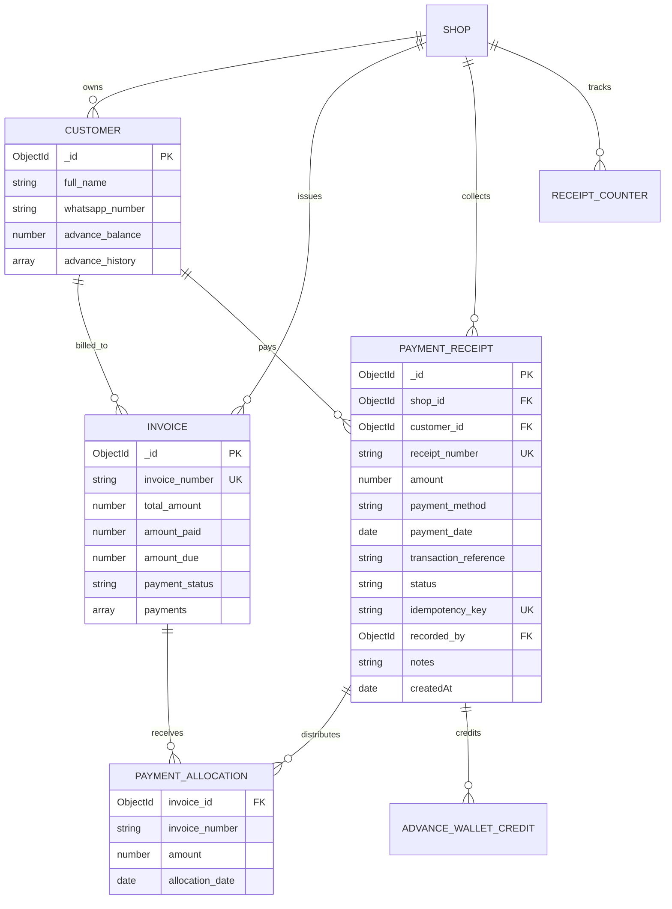

# Customer Ledger & Payment Architecture Specification
**Author**: Principal Full-Stack Software Engineer & Node.js/MongoDB Architect  
**Project**: WarrantyDesk (Sale2Service)  
**Status**: Architecture Standard & Implementation Contract

---

## 1. Architecture Overview & Core Principles

The WarrantyDesk Customer Account, Payment Collection & Ledger System upgrades the existing invoice-centric model into an enterprise-grade, double-entry-aligned accounting engine while ensuring **100% backward compatibility** and **zero data loss**.

### Financial Safety Rules Enforced:
1. **Rule A (No Silent Overwrite)**: Invoice edits (`PUT /invoices/:id`) cannot arbitrarily alter payment records or `amount_paid` without creating an auditable financial transaction.
2. **Rule B (Singular Receipt Collection)**: Each payment received represents actual legal tender once. Multi-invoice distributions are modeled as allocations linked to a parent `PaymentReceipt`.
3. **Rule C (No Advance Double-Counting)**: Adding funds to a customer's advance wallet is a Cash/UPI collection. Utilizing that wallet against an invoice is an **internal credit transfer**; it settles invoice dues without generating a duplicate cash collection.
4. **Rule D (Explainable Balances)**:
   $$\text{Customer Net Balance} = \sum \text{Invoiced Obligations} - \sum \text{Payments Received} - \sum \text{Exchange Credits} - \text{Advance Balance}$$
5. **Rule E (Immutable Audit Trail)**: Financial receipts are never hard-deleted. Corrections use controlled reversal entries (`status: 'REVERSED'`) with required reasons and staff authorization.
6. **Rule F (Zero Destructive Migration)**: Existing embedded arrays (`Invoice.payments` and `Customer.advance_history`) remain synced to prevent breaking legacy PDF or export pipelines.
7. **Rule G (Atomic Execution & Idempotency)**: All payment writes use idempotency keys (`idempotency_key` unique per shop) and atomic transactions.

---

## 2. Entity Relationship Model



---

## 3. Data Schema Specifications

### 3.1 Model: `PaymentReceipt` (`backend/models/PaymentReceipt.js`)

```javascript
import mongoose from "mongoose";

const paymentAllocationSchema = new mongoose.Schema(
  {
    invoice_id: {
      type: mongoose.Schema.Types.ObjectId,
      ref: "Invoice",
      required: true,
    },
    invoice_number: {
      type: String,
      required: true,
      trim: true,
    },
    amount: {
      type: Number,
      required: true,
      min: 0,
    },
    allocation_date: {
      type: Date,
      default: Date.now,
    },
  },
  { _id: true }
);

const paymentReceiptSchema = new mongoose.Schema(
  {
    shop_id: {
      type: mongoose.Schema.Types.ObjectId,
      ref: "Shop",
      required: true,
      index: true,
    },
    customer_id: {
      type: mongoose.Schema.Types.ObjectId,
      ref: "Customer",
      required: true,
      index: true,
    },
    receipt_number: {
      type: String,
      required: true,
      trim: true,
    },
    amount: {
      type: Number,
      required: true,
      min: 0.01,
    },
    payment_method: {
      type: String,
      enum: ["CASH", "UPI", "CARD", "BANK_TRANSFER", "CHEQUE", "WALLET", "OTHER"],
      default: "CASH",
    },
    payment_date: {
      type: Date,
      required: true,
      default: Date.now,
    },
    transaction_reference: {
      type: String,
      trim: true,
      default: "", // UPI UTR, Cheque No, Bank Trans ID
    },
    status: {
      type: String,
      enum: ["COMPLETED", "REVERSED", "BOUNCED"],
      default: "COMPLETED",
      index: true,
    },
    allocations: [paymentAllocationSchema],
    advance_amount_credited: {
      type: Number,
      default: 0,
      min: 0,
    },
    idempotency_key: {
      type: String,
      trim: true,
    },
    notes: {
      type: String,
      trim: true,
      default: "",
    },
    recorded_by: {
      type: mongoose.Schema.Types.ObjectId,
      ref: "User",
      required: true,
    },
    reversal_reason: {
      type: String,
      trim: true,
      default: null,
    },
    reversed_at: {
      type: Date,
      default: null,
    },
    reversed_by: {
      type: mongoose.Schema.Types.ObjectId,
      ref: "User",
      default: null,
    },
    deleted_at: {
      type: Date,
      default: null,
    },
  },
  {
    timestamps: true,
  }
);

// Indexes for high-performance tenant-isolated queries
paymentReceiptSchema.index({ shop_id: 1, receipt_number: 1 }, { unique: true });
paymentReceiptSchema.index(
  { shop_id: 1, idempotency_key: 1 },
  { unique: true, sparse: true }
);
paymentReceiptSchema.index({ shop_id: 1, customer_id: 1, payment_date: -1 });
paymentReceiptSchema.index({ shop_id: 1, "allocations.invoice_id": 1 });
paymentReceiptSchema.index({ shop_id: 1, deleted_at: 1, payment_date: -1 });
```

### 3.2 Model: `ReceiptCounter` (`backend/models/ReceiptCounter.js`)

Atomically generates daily sequential receipt numbers per shop in the collision-proof format:  
`REC-{YYMMDD}-{sequence}` (e.g. `REC-261105-001`).

```javascript
import mongoose from "mongoose";

const receiptCounterSchema = new mongoose.Schema({
  shop_id: {
    type: mongoose.Schema.Types.ObjectId,
    ref: "Shop",
    required: true,
  },
  date: {
    type: String, // Format: YYMMDD
    required: true,
  },
  seq: {
    type: Number,
    default: 0,
  },
});

receiptCounterSchema.index({ shop_id: 1, date: 1 }, { unique: true });
```

---

## 4. Chronological Ledger Event Engine (`backend/services/customerLedgerService.js`)

### 4.1 Accounting Event Stream Specification

The ledger merges all financial occurrences into a single chronological timeline:

| Event Type | Trigger | Signed Amount | Running Balance Effect | Economic Meaning |
| :--- | :--- | :---: | :---: | :--- |
| `INVOICE_CREATED` | Invoice issued | **Debit (+)** | Increases Customer Due | Customer incurred a legal payable obligation |
| `PAYMENT_RECEIVED` | Cash/UPI received | **Credit (-)** | Decreases Customer Due | Customer paid real funds settling dues |
| `ADVANCE_DEPOSIT` | Wallet deposit | **Credit (-)** | Creates Customer Store Credit | Customer deposited advance credit |
| `ADVANCE_APPLIED` | Wallet deducted for bill | **Informational** (Net ₹0) | Internal Balance Rebalancing | Wallet decrements; bill dues decrement. Net customer position is unchanged. |
| `PAYMENT_REVERSED` | Bounced cheque / error | **Debit (+)** | Restores Customer Due | Reverses previous credit |
| `EXCHANGE_CREDIT` | Old battery excess credit | **Credit (-)** | Decreases Customer Due | Credit given for trade-in excess |

### 4.2 Opening & Closing Balance Logic

When a user requests a filtered statement for date range $[T_{\text{start}}, T_{\text{end}}]$:

1. **Calculate Opening Balance ($B_0$)**:
   Aggregate all events with $\text{effective\_date} < T_{\text{start}}$:
   $$B_0 = \sum_{t < T_{\text{start}}} \text{Debits}(t) - \sum_{t < T_{\text{start}}} \text{Credits}(t)$$
2. **Compute In-Period Running Balance**:
   Sort in-period events chronologically by $\text{effective\_date} \text{ ASC}, \text{createdAt} \text{ ASC}$.  
   For each event $i$:
   $$\text{Running Balance}_i = \text{Running Balance}_{i-1} + \text{Debit}_i - \text{Credit}_i$$
3. **Verify Closing Balance ($B_{\text{close}}$)**:
   $$B_{\text{close}} = B_0 + \sum \text{In-Period Debits} - \sum \text{In-Period Credits}$$
   This reconciles against the customer's live database balance:
   $$B_{\text{close}} \equiv \sum \text{Unpaid Invoices Due} - \text{Advance Balance}$$

---

## 5. Universal Payment Allocation Logic

```mermaid
flowchart TD
    Start([User Initiates Payment]) --> Mode{Select Payment Mode}
    
    Mode -->|Mode A: Auto FIFO| AutoFIFO[Identify all unpaid/partial bills<br>Sort oldest invoice_date first]
    Mode -->|Mode B: Manual Allocation| ManualAlloc[User specifies exact amount<br>per selected invoice]
    Mode -->|Mode C: Direct Advance Deposit| DirectAdv[All funds deposited into<br>Customer Advance Wallet]
    
    AutoFIFO --> AllocLoop[Distribute payment sequentially]
    ManualAlloc --> ValidateSum{Sum of allocations<br><= Total Received?}
    
    ValidateSum -->|No| Error[Reject: Allocations exceed payment]
    ValidateSum -->|Yes| CheckExcess{Payment > Total Invoices Settled?}
    
    AllocLoop --> CheckExcess
    
    CheckExcess -->|Yes| CreditWallet[Credit Remaining Excess to<br>Customer Advance Wallet]
    CheckExcess -->|No| NoExcess[Complete Invoices Settlement]
    
    CreditWallet --> AtomicWrite[Atomic Transaction:<br>1. Create PaymentReceipt<br>2. Update Invoice totals & payments[]<br>3. Update Customer advance_balance<br>4. Append to advance_history[]]
    NoExcess --> AtomicWrite
    DirectAdv --> AtomicWrite
    
    AtomicWrite --> SendWA{WhatsApp Enabled?}
    SendWA -->|Yes| MSG91[Send MSG91 Payment Receipt]
    SendWA -->|No| Finish([Return Success Response])
    MSG91 --> Finish
```

---

## 6. API Route Contracts

### `POST /v1/customers/:id/payments`
Creates a payment receipt with atomic allocations and idempotency.
- **Headers**: `Authorization: Bearer <token>`
- **Request Body**:
  ```json
  {
    "amount": 5000,
    "payment_method": "UPI",
    "payment_date": "2026-11-05T09:00:00.000Z",
    "transaction_reference": "UPI-987654321",
    "allocation_mode": "AUTO_FIFO", // or "MANUAL" or "ADVANCE_ONLY"
    "allocations": [
      { "invoice_id": "67298...", "amount": 3000 }
    ],
    "notes": "Diwali clearance",
    "send_whatsapp": true,
    "idempotency_key": "c4b12df7-8ef3-4632-9cb0-18451b66ec0a"
  }
  ```
- **Response `201 Created`**:
  ```json
  {
    "success": true,
    "message": "Payment of ₹5,000 recorded successfully. Receipt #REC-261105-001 generated.",
    "data": {
      "receipt": {
        "_id": "...",
        "receipt_number": "REC-261105-001",
        "amount": 5000,
        "payment_method": "UPI",
        "allocations": [...],
        "advance_amount_credited": 0
      },
      "customer": {
        "advance_balance": 0,
        "total_due": 0
      }
    }
  }
  ```

### `POST /v1/payments/:id/reverse`
Reverses a previously recorded payment receipt.
- **Permission**: `customers_edit` or `invoices_edit` (Role: `OWNER`, `ADMIN`)
- **Request Body**:
  ```json
  {
    "reason": "Cheque bounced by ICICI Bank"
  }
  ```
- **Response `200 OK`**:
  Restores invoice dues and debits any advance balance created by the reversed receipt.

### `GET /v1/customers/:id/ledger`
Returns complete chronological statement with running balance and opening balance.
- **Query Params**: `startDate`, `endDate`, `type` (`ALL`, `INVOICES`, `PAYMENTS`, `ADVANCES`), `page`, `limit`
- **Response**:
  ```json
  {
    "success": true,
    "data": {
      "customer": { ... },
      "summary": {
        "total_invoiced": 15000,
        "total_paid": 12000,
        "total_due": 3000,
        "advance_balance": 500,
        "net_receivable": 2500,
        "last_payment_amount": 5000,
        "last_payment_date": "2026-11-05T09:00:00.000Z"
      },
      "statement": {
        "opening_balance": 0,
        "closing_balance": 2500,
        "total_debits": 15000,
        "total_credits": 12500,
        "entries": [ ... ]
      }
    }
  }
  ```

